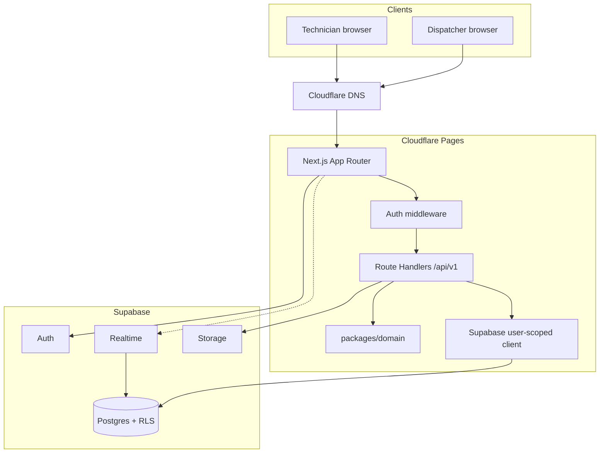
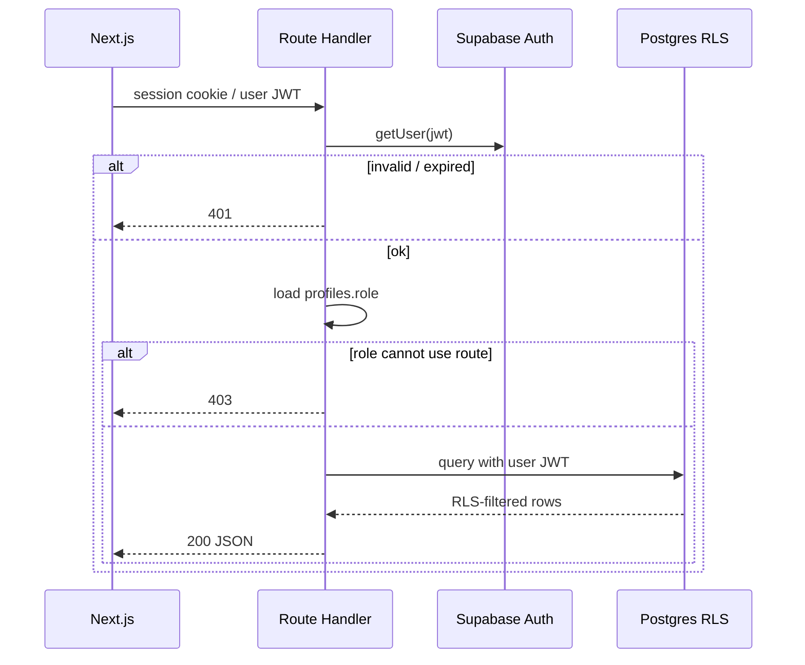
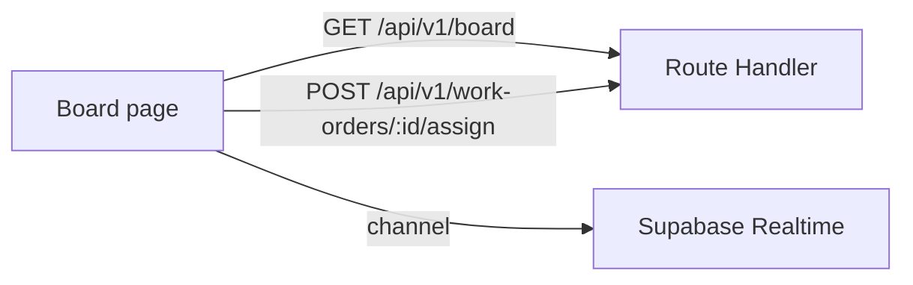
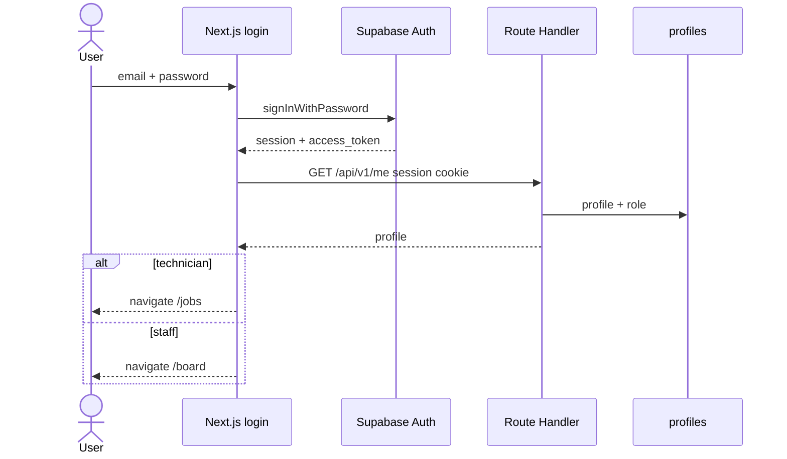
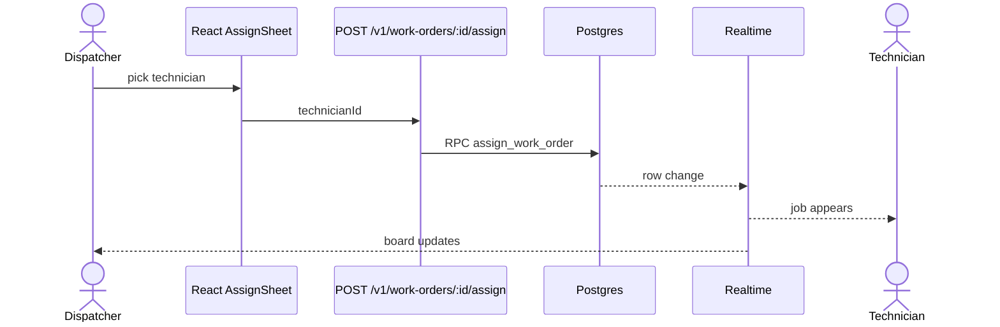
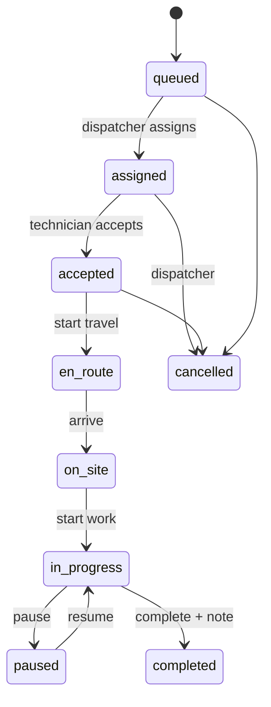

# ARCHITECTURE.md — System Architecture

**Product:** CrewPulse  
**Related:** [[STACK]] · [[PRD]] · [[CLOUDFLARE]] · [[SUPABASE]] · [[SCHEMA]] · [[MARKITDOWN]] · [[SLOT-ADHERENCE]] · [[RULES]] · [[DESIGN]] · [[SKILLS]]

One app: **Next.js (App Router)** + **Supabase database** + **Cloudflare DNS**. Shared domain in `packages/domain`.

---

## 1. System Overview & High-Level Diagram



**Design methodology:** one Next.js app, one shared domain package. The browser never talks to Postgres with the secret key. Route Handlers can return JSON; Server Components can render HTML.

**Primary patterns**

| Pattern | Where |
| --- | --- |
| App Router UI | `apps/web` |
| REST JSON API | `apps/web` Route Handlers `/api/v1` |
| Shared domain | `packages/domain` |
| Result / typed errors | API boundary |
| Status state machine | `packages/domain` |
| RLS | Postgres — last line of defense |
| Repository functions | `apps/web/src/db/` |

---

## 2. Layered Architecture & Conventions

```text
apps/web          Next.js App Router: pages, Route Handlers, db access
packages/domain   Pure TS: status machine, roles, IDs
supabase/         Migrations, seed
```

**API layers**

```text
┌─────────────────────────────────────────────┐
│  app/api/v1      Next.js Route Handlers      │
├─────────────────────────────────────────────┤
│  services/       Use-cases (assign, etc.)    │
├─────────────────────────────────────────────┤
│  domain/         packages/domain             │
├─────────────────────────────────────────────┤
│  db/             Supabase queries / RPC      │
└─────────────────────────────────────────────┘
```

**Dependency rule**

- `packages/domain` imports nothing from React, Next.js, or Supabase.
- Client components do not import secret-key / admin clients.
- Status-machine writes go through Route Handlers + domain, not ad-hoc Server Actions.

**Conventions**

- JSON envelopes: `{ ok: true, data } | { ok: false, code, message }`.
- Zod on every API body/query.
- React calls `/v1/...` with `Authorization: Bearer <supabase access_token>`.
- Realtime stays in the browser against Supabase (user JWT). Mutations go through the API so the status machine stays server-side.

---

## 3. Directory & Domain Structure

```text
apps/
  web/
    src/
      app/
        layout.tsx
        page.tsx
        login/
        board/
        work-orders/
        jobs/
        teams/
        technicians/
        settings/
        messages/
        map/
        api/v1/
          health/
          me/
          board/
          work-orders/
          presence/
          teams/
          notifications/
      features/
        auth/
        presence/
        work-orders/
        notifications/
      shared/ui/          restyled primitives
      db/
      services/
      lib/
        supabase/
          env.ts
          client.ts
          server.ts
          middleware.ts
          context.ts
          admin.ts
      middleware.ts
packages/
  domain/
    src/
      work-order-status.ts
      roles.ts
      ids.ts
supabase/
  migrations/
  seed.sql
```

**Domains**

| Domain | Owns |
| --- | --- |
| Identity | profiles, session |
| Org structure | teams, membership |
| Dispatch | work orders, assignment, events |
| Monitoring | presence, board |
| Notify | in-app notifications; Phase 3 email outbox (Resend or console) |
| Field ops (Phase 4) | location pings, checklists |
| Chat (Phase 4) | standalone messaging: DM threads, dispatcher channel, per-job threads |
| Map (Phase 4) | interactive GPS map centered on Davao North, clickable technician markers |

---

## 4. Middleware & Request Pipeline



**Route gates**

| Prefix / resource | Roles |
| --- | --- |
| `POST /api/v1/auth` not used | Login is Supabase Auth from Next.js |
| `GET /api/v1/board`, work-orders, teams, technicians | admin, dispatcher, team_lead |
| `GET /api/v1/jobs` | technician |
| `GET /api/v1/me`, `PATCH /api/v1/me`, heartbeat | any authenticated |
| Phase 4 `/map` | admin, dispatcher, team_lead — see [[SCHEMA]] |
| Phase 4 `/messages`, `/v1/chat/*` | any authenticated — see [[SCHEMA]] |
| Phase 4 checklist | see [[SCHEMA]] — not in Phase 1 |

Fine-grained rows: **RLS** ([[SCHEMA]]). Middleware is coarse role only.

---

## 5. Client-Side Architecture

- Next.js App Router. Auth session in `@supabase/ssr` cookies (refreshed in middleware).
- TanStack Query for client API reads/mutations.
- Filters in the URL (`?team=&status=&priority=`).
- Presence board: initial server load or `GET /api/v1/board`, then Realtime on `technician_presence` + `work_orders`.
- No Redux. No global work-order store.
- UI craft: [[DESIGN]] + [[SKILLS]] (`emilkowalski/skills`).



---

## 6. Data Layer & Database Strategy

- SQL migrations in `supabase/migrations/` — source of truth.
- Route Handlers use a Supabase client **authenticated as the user** (RLS applies).
- Secret key only in seed/admin scripts on the server, never in `NEXT_PUBLIC_*`.
- Realtime from the browser. Storage Phase 1.5 via signed URLs.
- Prefer RPCs `assign_work_order` and `transition_work_order` for races.

See [[SUPABASE]] and [[SCHEMA]].

Phase 2 report ingest: dispatcher uploads `.xlsx` → in-memory `exceljs` parse → `slot_adherence_rows` (no raw file in Storage). Details in [[SLOT-ADHERENCE]].

Phase 4 tables (`technician_location_pings`, `work_order_messages`, checklists) are specified in [[SCHEMA]] and **must not** be migrated until Phase 4.

---

## 7. Authentication Flow



- Public signup UI: **off**. Seed or admin invite.
- Trigger: `on_auth_user_created` → `profiles` when invite metadata has `org_id` + `role`.
- Sign-out: `supabase.auth.signOut()` on the client.

---

## 8. Key Data Flows & Sequence Diagrams

### 8.1 Assign a work order



### 8.2 Technician status walk



Transitions: `packages/domain` **and** Postgres RPC. The UI hides illegal buttons.

### 8.3 Heartbeat

Client every 30s → `POST /api/v1/presence/heartbeat`. Board treats `last_seen_at > 90s` as `offline`.

---

## 9. Domain Logic Highlights

Same rules as before, now in `packages/domain` and enforced on the API:

- `canTransition(from, to, role)`
- One assignee; block `offline` in MVP
- Team lead scoped by RLS + service check
- Completing a job sets presence `available` if no other active job
- `WO-{year}-{seq}` from Postgres

---

## 10. Cross-Cutting Concerns

### Error handling

- `DomainError` codes: `ILLEGAL_TRANSITION`, `NOT_ASSIGNEE`, `FORBIDDEN`
- HTTP: 401 / 403 / 404 / 409 / 422 with `{ ok: false, code, message }`
- React: error boundary + query error UI. No stack traces.

### Validation

Zod in Route Handlers and matching schemas in client forms. See [[RULES]].

### Security

- CORS allowlist: `localhost:3000` + `https://app.<domain>` ([[CLOUDFLARE]])
- RLS on; secret key never in the browser
- Storage paths `{org_id}/{work_order_id}/{file}`

### Performance

- Board selects lean columns
- Realtime filtered by `org_id`
- Events loaded on the detail page only

### Logging

- API: `console.error` with request id + code. No tokens in logs.
- `audit_logs` on assign / cancel / role changes; admin UI at `/settings/audit` (Phase 3)

### Testing

- Domain: Vitest, no I/O
- Route Handlers: integration against local/cloud Supabase when available
- Web: Playwright demo script from [[PRD]]
