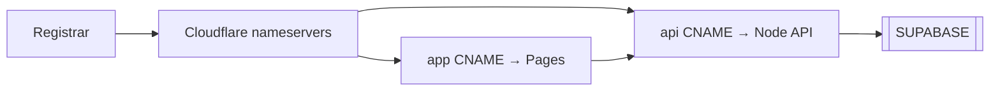

# CLOUDFLARE.md — DNS

**Product:** CrewPulse  
**Decision:** **Cloudflare is the DNS server. Locked.**  
**Related:** [[STACK]] · [[ARCHITECTURE]] · [[PRD]]

Cloudflare is the **authoritative DNS** for the product domain. It is not the database and not the Next.js runtime requirement in Phase 1.

---

## 1. What Cloudflare owns

| Capability | MVP | Notes |
| --- | --- | --- |
| Nameservers | Yes | Point the registrar to Cloudflare NS |
| A / AAAA / CNAME records | Yes | `app`, `api`, apex |
| SSL/TLS | Yes | **Full (strict)** once origins have valid certs |
| HTTP → HTTPS redirect | Yes | Always |
| Proxy (orange cloud) | Yes for `app` | Optional for `api` if WebSockets/timeouts fight the proxy |
| Cloudflare Pages | Yes (app host) | Next.js from `apps/web` |
| WAF / rate limit | Later | Not required for demo |
| Workers as the API | No | App is Next.js ([[STACK]]) |
| Cloudflare D1 / KV as DB | No | Database is [[SUPABASE]] |

---

## 2. Hostname plan

Replace `example.com` with the real domain when purchased. Record it here.

| Field | Value |
| --- | --- |
| Domain | _paste when bought_ |
| Zone ID | _paste_ |
| Account | _paste_ |

| Name | Type | Target | Proxy |
| --- | --- | --- | --- |
| `app` | CNAME | `<project>.pages.dev` | Proxied |
| `@` | CNAME / redirect | `app.example.com` | Proxied |
| `www` | CNAME | `app.example.com` | Proxied |

Local development does **not** use Cloudflare DNS (`localhost:3000`).

---

## 3. Setup steps (when a domain exists)

1. Add the site in [Cloudflare Dashboard](https://dash.cloudflare.com) → choose the Free plan.
2. At the registrar, set nameservers to the two Cloudflare NS hosts.
3. Wait until the zone status is **Active**.
4. Create the records in the table above.
5. SSL/TLS mode: **Full (strict)**.
6. Attach the Pages project to `app`.
7. Public env on Pages: `NEXT_PUBLIC_SUPABASE_URL`, `NEXT_PUBLIC_SUPABASE_PUBLISHABLE_KEY`. Secret key is a **server-only** Pages env var, never `NEXT_PUBLIC_*`.

> [!warning] Do not
> - Point DNS at Supabase as if it were the app
> - Use Flexible SSL (mixed content / cookie issues)
> - Put the secret key in Pages env as `NEXT_PUBLIC_*`

---

## 4. CORS and cookies

- App origin `https://app.example.com` (and localhost in dev).
- Auth is **Supabase session cookies** via `@supabase/ssr`, not Cloudflare Access.
- Realtime goes from the browser to `*.supabase.co` (no Cloudflare DNS required).

---

## 5. How this fits the rest

#cloudflare #dns #crewpulse
