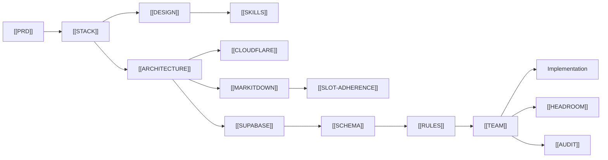

---
title: CrewPulse Documentation Index
aliases: [MOC, Documentation System, Home]
tags: [crewpulse, moc, docs]
cssclasses: [moc]
---

# CrewPulse — Documentation System

**Product:** CrewPulse  
**Project:** Technician Team Management & Monitoring System  
**Rule:** Read these files before writing any code. Stay inside this scope.

## Source-of-truth files

| File | Job | Open when |
| --- | --- | --- |
| [[PRD]] | Scope, users, MVP, metrics, phases | Deciding *what* to build. Phase 4 = GPS/chat/checklist (docs only until Phase 1 ships) |
| [[STACK]] | Locked tech: Cloudflare DNS, Next.js, Supabase | Choosing libraries or hosts |
| [[DESIGN]] | Brand, tokens, layout, motion, a11y | Building any UI |
| [[SKILLS]] | `npx skills add emilkowalski/skills` | Frontend polish and animation |
| [[ARCHITECTURE]] | Layers, folders, auth, data flow | Adding a feature or route |
| [[CLOUDFLARE]] | DNS, SSL, hostnames | Domain and deploy |
| [[SUPABASE]] | Postgres, Auth, RLS, Realtime, Storage | Creating the database / env / CLI |
| [[MARKITDOWN]] | Microsoft MarkItDown: Excel/PDF → markdown | Broken files and report ingest |
| [[SLOT-ADHERENCE]] | Slot adherence report from CRM/BSS xlsx | Uploading `20260615 all status.xlsx` |
| [[SCHEMA]] | Tables, columns, RLS policies, API contracts | Touching data or endpoints |
| [[RULES]] | SOLID, DRY×4, KISS, TS, security | Writing or reviewing code |
| [[TEAM]] | Four-agent crew every session | Any feature: Architect → Coder → Tester → Manager |
| [[HEADROOM]] | Headroom in Cursor (compress / retrieve / stats) | Every Agent chat; not a product feature |
| [[AUDIT]] | PPE & equipment audit spec: tables, routes, workflow | Building or referencing the audit / PPE inspection feature |

## How this system is used

1. **Before coding** — confirm the work is in the current phase of [[PRD]].
2. **While coding** — match [[DESIGN]] + [[SKILLS]] on the Next.js app, [[ARCHITECTURE]] folders, [[CLOUDFLARE]] for DNS. Database is [[SUPABASE]] only. Never invent a new table without updating [[SCHEMA]].
3. **When stuck** — change the doc first, then the code. Docs lead; code follows.
4. **Out of scope** — park it. Do not implement “nice to have” items from later phases.

> [!important] Scope lock
> If a request is not in the current phase of [[PRD]], refuse it and log it under Later / Out of MVP. Career-project velocity comes from saying no.

## Obsidian + Cursor

Canonical files live in the repo: `context/`.  
This folder is also an Obsidian vault. The personal vault links here from [[CrewPulse Hub]].

See [[OBSIDIAN-CURSOR]] for the connection steps.  
Cursor Agent chats use [[HEADROOM]] for context compression (MCP on this machine).

## Tags

#crewpulse #prd #stack #design-system #skills #architecture #cloudflare #schema #supabase #markitdown #slot-adherence #rules #team #headroom #audit #ppe
