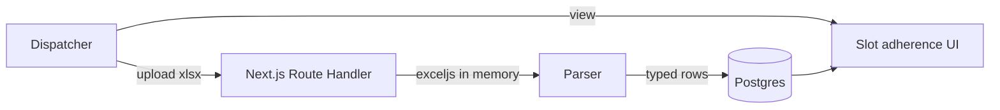

# MARKITDOWN.md — Microsoft MarkItDown

**Product:** CrewPulse  
**Decision:** Use **Microsoft MarkItDown** to turn messy Excel, PDF, Word, and similar files into Markdown (and then into structured rows). Locked for report ingest.  
**Related:** [[SLOT-ADHERENCE]] · [[STACK]] · [[PRD]] · [[SCHEMA]] · [[ARCHITECTURE]]

Source: [microsoft/markitdown](https://github.com/microsoft/markitdown)

> [!important] Why this exists
> Raw ops files (especially Excel with merged cells, pivots, and “AM Slot / PM Slot” text) do not import cleanly. MarkItDown preserves tables and headings as Markdown so the TypeScript API can parse them instead of guessing broken cell layouts.

---

## 1. What we use it for

| Input | Use in CrewPulse |
| --- | --- |
| `.xlsx` / `.xls` | Slot adherence and all-status dumps — [[SLOT-ADHERENCE]] |
| `.pdf` | Printed/exported reports with broken copy-paste |
| `.docx` / `.pptx` | Later, if ops send write-ups |
| Images in those files | Optional OCR via `markitdown-ocr` (not required for the June 2026 xlsx) |

Not a replacement for [[SUPABASE]]. MarkItDown is an **ingest preprocessor**. Parsed facts still land in Postgres.

---

## 2. Install (local / API sidecar)

Python 3.10+ via `uv` (this machine has `uv`; the Store `python` stub is not enough).

```powershell
# Excel + PDF extras
uvx --from "markitdown[xlsx,pdf]" markitdown --help

# Convert a file to markdown
uvx --from "markitdown[xlsx,pdf]" markitdown "path\to\file.xlsx" -o "path\to\file.md"

# Enable 3rd-party plugins (OCR, etc.)
uvx --from "markitdown[xlsx,pdf]" --with markitdown-ocr markitdown --use-plugins "path\to\file.pdf" -o out.md
```

Python API:

```python
from markitdown import MarkItDown

md = MarkItDown(enable_plugins=False)
result = md.convert(r"C:\Users\arvnd\Downloads\20260615 all status.xlsx")
# result.text_content  → markdown tables
```

> [!warning] PII
> Do **not** commit MarkItDown output of the raw workbook into git or Obsidian. It contains customer names, phones, and addresses. Convert locally; persist only mapped report columns (see [[SLOT-ADHERENCE]]).

---

## 3. Runtime in the app

The product API is TypeScript ([[STACK]]). MarkItDown is Python. Call it as a **sidecar**, not as Edge Functions.



| Rule | Detail |
| --- | --- |
| Primary path | `exceljs` parses Sheet2 in memory. **Raw file is not stored** in Supabase Storage. |
| Replace | Each upload deletes the org's prior `report_uploads` + `slot_adherence_rows` snapshot. |
| MarkItDown | Optional sidecar for PDF / broken sheets only — not used for the standard CRM/BSS xlsx |
| Timeout | 60s parse; 120s if >10k rows |
| Security | Parse from in-memory buffer or local temp only. Never pass user URLs into MarkItDown |

---

## 4. Known template vs broken files

| Kind | Tool |
| --- | --- |
| `20260615 all status.xlsx` shape (201 cols, `appointmentdate` = `YYYY-MM-DD AM/PM Slot`) | Structured parse + MarkItDown as a debug/preview |
| Pivot-only PDF or screenshot export | MarkItDown (+ OCR plugin if scanned) |
| Random merged-header Excel | MarkItDown first, then map columns by header aliases |

Header aliases for this dump live in [[SLOT-ADHERENCE]].

---

## 5. CLI cheat sheet

```powershell
uvx --from "markitdown[xlsx,pdf]" markitdown --list-plugins
uvx --from "markitdown[xlsx,pdf]" markitdown "C:\Users\arvnd\Downloads\20260615 all status.xlsx" -o "$env:TEMP\all-status.md"
```

#markitdown #excel #reports #crewpulse
