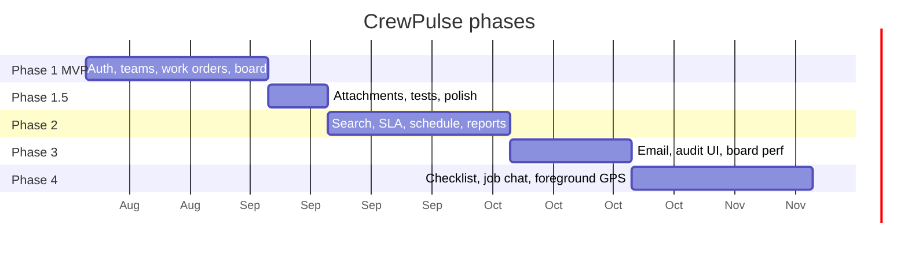

# PRD.md — Product Requirements Document

**Product:** CrewPulse  
**Full name:** Technician Team Management & Monitoring System  
**Type:** Career / portfolio web application  
**Status:** Locked for Phase 1 (MVP)  
**Related:** [[STACK]] · [[DESIGN]] · [[ARCHITECTURE]] · [[CLOUDFLARE]] · [[SUPABASE]] · [[SCHEMA]] · [[SKILLS]] · [[MARKITDOWN]] · [[SLOT-ADHERENCE]] · [[RULES]]

---

## 1. Executive Summary

CrewPulse is a **dispatcher-first web app** for assigning, tracking, and monitoring field technician teams in real time.

A supervisor opens a live board, sees who is available, assigns a work order, and watches status move from *queued → en route → on site → completed*. A technician opens a simple job screen, accepts the work, updates status, and logs completion notes.

This is **not** a generic CRM, not a full ERP, and not a customer self-service marketplace. It is an **operations console** plus a **technician job view**.

**One-sentence pitch:**  
*CrewPulse shows a dispatcher the live state of every technician and every job, then makes assignment and follow-through fast.*

**Industry focus:** Broadband / ISP field operations — Fiber-to-the-Home (FTTH), CPE installation, line repair, GPON troubleshooting, aerial and underground cable works  
**Work order types (from CRM/BSS):** Install (PR / PV / CH), Repair, Migration, Dedicated Migration — matching the `orderactiontype` and `skillset` columns in the CRM/BSS all-status export ([[SLOT-ADHERENCE]])  
**Geographic focus:** Davao North district, Davao City, Philippines (Region: MINDANAO / Area: SOUTH MINDANAO 1 / Territory: DAVAO NORTH)  
**Primary users:** Broadband team Technicians, Dispatchers, Operations Managers, and support staff  
**Contractor context:** Field operations executed primarily by contractor teams (e.g., NG KHAI in the sample dump); CrewPulse tracks the technician-level assignment within those contractor teams

**In scope for the career project**
- Multi-role auth (Admin, Dispatcher, Team Lead, Technician)
- Teams, technicians, skills
- Work orders with status machine
- Live presence / status board with **tabbed interface** (Technicians tab + Work Orders tab)
- Activity timeline per job
- Dark operational UI (see [[DESIGN]])
- **Live GPS map** with interactive technician markers (click for details)
- **Standalone chat messaging** — any user can message any technician; default dispatcher channel for customer install/repair requests
- **Phase 2:** Upload CRM/BSS Excel and show **slot adherence** ([[SLOT-ADHERENCE]], ingest via [[MARKITDOWN]])
- **Phase 4:** **PPE / equipment audit** — technician self-declares their personal protective equipment and tools before each job; supervisor can view and flag submissions ([[AUDIT]])

**Hard out of scope (do not build)**
- Customer login portal
- Route optimization / Google Maps turn-by-turn
- Payroll, invoicing, inventory purchasing
- Native iOS / Android apps (responsive web only)
- AI auto-dispatch
- Multi-tenant marketplace / public signup for random companies

---

## 2. Core Goals & Objectives

### Product goals

| ID | Goal | Why it exists |
| --- | --- | --- |
| G1 | Dispatch a job in under 60 seconds | The core demo moment |
| G2 | Show live technician status without refresh | Monitoring is the product, not a report |
| G3 | Keep a complete job timeline | Accountability and portfolio evidence |
| G4 | Role-appropriate screens | Dispatcher density vs technician simplicity |
| G5 | Stay demoable on a laptop | Career project must present in 8 minutes |

### Project objectives

- Ship a **narrow, finished MVP** rather than a wide unfinished SaaS.
- Use a stack that is employable and explainable: Next.js, TypeScript, Supabase, Cloudflare DNS. See [[STACK]].
- Make architecture and design *intentional* — this documentation is part of the portfolio.
- Prefer real constraints (roles, status machine, RLS) over decorative features.

### Non-goals

- Pixel-perfect marketing landing page as the main effort.
- Building every field-service feature a real company would need.
- Premature microservices, Kubernetes, or event buses.

---

## 3. Target Users & Audience

### Primary users (inside the product)

| Role | Who | Main job in CrewPulse | Device |
| --- | --- | --- | --- |
| **Dispatcher** | Operations coordinator | Assign work, watch the board, chase overdue jobs | Desktop |
| **Technician** | Field worker | See my jobs, update status, complete with notes | Phone / tablet |
| **Team Lead** | Senior tech / crew chief | Same as dispatcher, limited to their team | Desktop + phone |
| **Admin** | Ops manager / owner | Users, teams, skills, org settings | Desktop |

### Secondary audience (outside the product)

- Hiring managers and technical interviewers reviewing this repo.
- The developer (you) — these docs exist so implementation does not drift.

### User stories (MVP)

**Dispatcher**
- As a dispatcher, I can see all technicians and their current status on one board.
- As a dispatcher, I can create a work order with site, priority, and required skill.
- As a dispatcher, I can assign a work order to an available technician (or a team).
- As a dispatcher, I can filter the board by team, status, and priority.

**Technician**
- As a technician, I see only *my* assigned jobs.
- As a technician, I can accept, start travel, arrive, complete, or pause a job.
- As a technician, I can add a completion note and optional photo.

**Admin**
- As an admin, I can invite users, set roles, create teams, and deactivate accounts.

**Team Lead**
- As a team lead, I can dispatch and monitor only my team’s technicians and jobs.

---

## 4. Problem Statement

Field teams still run on group chats, spreadsheets, and “just call the tech.” That fails in three predictable ways:

1. **No live picture** — the office does not know who is free, who is stuck, or who went silent.
2. **Slow, ambiguous assignment** — jobs are pasted into chat; two techs show up or nobody does.
3. **No trail** — when a customer asks “what happened?”, there is no status history.

Existing tools (full FSMS suites) are heavy, expensive, and designed for enterprises. CrewPulse solves the **monitoring + assignment loop** for a single organization, with a UI that feels like a control room rather than a generic dashboard template.

**Problem statement (locked):**  
Supervisors cannot see technician availability and job progress in one place, so assignment is slow and status is tribal knowledge.

---

## 5. MVP Features

MVP = **Phase 1**. If it is not listed here, it is not in the first ship.

### 5.1 Authentication & org

- Email/password auth via Supabase.
- One organization (seeded). No public self-serve org creation.
- Roles: `admin` | `dispatcher` | `team_lead` | `technician`.
- Session-gated app shell. Unauthenticated users only see `/login`.

### 5.2 People & teams

- Profiles: name, phone, role, active flag, optional avatar.
- Teams: name, color token, optional lead.
- Assign technicians to one primary team.
- Skills catalog + technician skill tags (used when assigning).

### 5.3 Work orders

- Create / edit work order: title, description, customer name, phone, site address, priority, required skill (optional), scheduled window.
- Auto-generated human ID: `WO-2026-0001`.
- Assign to a technician (required for “assigned”) or leave in queue.
- Status machine (locked):

```text
draft → queued → assigned → accepted → en_route → on_site → in_progress → completed
                                              ↘ paused ↗
any non-terminal → cancelled
completed → needs_followup (optional)
```

- Priority: `low` | `medium` | `high` | `critical`.
- Timeline of status changes and notes.
- Completion note required to mark `completed`.

### 5.4 Live monitoring board (tabbed)

The board uses a **tabbed interface** — only the selected tab's content is displayed:

- **Technicians tab** (default for dispatchers) — technician cards grouped by presence status (`offline`, `available`, `on_break`, `en_route`, `on_site`).
- Each card: name, team color, current job (if any), last seen.
- **Work Orders tab** — kanban or table view: filter by status, team, priority.
- Presence updates over Supabase Realtime (no full page refresh).
- Technician “My Jobs” list with primary action button matching legal next statuses.

### 5.5 Notifications (in-app only)

- In-app bell: “Job assigned”, “Job accepted”, “Job completed”, “Job cancelled”.
- Mark read. No email/SMS/push in MVP.

### 5.6 Seed & demo

- Seed script: 1 org, 1 admin, 2 dispatchers, 2 teams, 8 technicians, ~12 work orders in mixed statuses.
- All sample data references **Davao North district, Davao City, Philippines** — barangays: Bunawan, Panacan, Sasa, Buhangin, Cabantian, Indangan, Communal, Tigatto, Mandug, Pampanga, Langub, Callawa.
- Skills seeded for broadband (matching CRM/BSS `skillset` values): Fiber Splicing, CPE Installation, Line Repair, GPON Troubleshooting, Aerial Cable, Underground Cable.
- Work order action types match the CRM/BSS `orderactiontype` values: Install (PR = Provisioning, PV = Pre-visit, CH = Change), Repair, Migration.
- Work orders use realistic broadband titles drawn from actual CRM/BSS patterns:
  - **Repair:** No internet — fiber cut, Slow speed complaint, ONT replacement — blinking red LOS, GPON OLT port failure — affects 32 subs, Line noise — intermittent disconnect
  - **Install:** New FTTH install — residential, CPE config — new business subscriber, WiFi router replacement
  - **Infrastructure:** Aerial cable sagging — road crossing, Underground fiber break — road construction, Fiber splice closure repair

### Explicitly not in MVP

File-heavy galleries, reports PDF, SLA clocks, recurring jobs, customer portal, dark/light *custom brand theme builder*. GPS breadcrumb history / background tracking remains out of scope. (Maps + interactive GPS, standalone chat, and PPE checklist are in **Phase 4** — see §10.)

---

## 6. Full Feature List & Prioritization

Use **MoSCoW**. Only **Must** ships in Phase 1.

| Feature | Priority | Phase | Notes |
| --- | --- | --- | --- |
| Auth + roles + RLS | Must | 1 | Foundation |
| Teams & members | Must | 1 | |
| Skills | Must | 1 | Simple tags |
| Work order CRUD + status machine | Must | 1 | Core |
| Assignment to technician | Must | 1 | |
| Live presence board | Must | 1 | Differentiator |
| Job timeline / events | Must | 1 | |
| In-app notifications | Must | 1 | |
| Technician mobile job view | Must | 1 | Responsive, not a PWA store app |
| Seed / demo data | Must | 1 | |
| Photo attachment on complete | Should | 1 if time, else 2 | Supabase Storage |
| Team-lead scoped dispatch | Should | 1 | Same UI, tighter RLS |
| **Excel upload → slot adherence report** | **Must** | **2** | Template: `20260615 all status.xlsx`. See [[SLOT-ADHERENCE]] |
| MarkItDown ingest for Excel/PDF | Must | 2 | [[MARKITDOWN]] |
| Search work orders | Should | 2 | |
| Shift / schedule calendar | Should | 2 | |
| SLA timer & overdue highlight | Should | 2 | Live jobs; dump aging is separate |
| Last-known location ping | Won’t | — | Superseded by Phase 4 foreground GPS. Do not build a second tracker. |
| Email notifications | Could | 2 | |
| Basic reports (jobs/day, time on site) | Could | 2 | Slot adherence is the primary report |
| Customer portal | Won’t | — | Out of project |
| Route optimization | Won’t | — | Out of project |
| Inventory / parts | Won’t | — | Out of project |
| Native apps | Won’t | — | Out of project. Technician uses responsive web. |
| AI dispatch | Won’t | — | Out of project |
| Pre-deploy safety checklist | Must | 4 | Hard gate before `en_route`. Per-skill templates. |
| Standalone chat messaging | Must | 4 | DMs + dispatcher channel + per-job threads. Accessible from /messages. |
| Interactive GPS map + foreground stream | Must | 4 | Full map of Davao North. Clickable technician markers with details popup. Opt-in, foreground only. |

---

## 7. Success Metrics

### Product metrics (demo + realistic targets)

| Metric | Target | How we know |
| --- | --- | --- |
| Time to assign a queued job | < 60 seconds | Stopwatch on demo script |
| Presence propagation | < 5 seconds | Status change visible on second browser |
| Illegal status transition | 0 allowed | Server rejects; UI hides invalid actions |
| Role leak | 0 | Technician cannot read other techs’ jobs |
| Demo script completion | 8 minutes | Login → board → assign → accept → complete |

### Engineering metrics

| Metric | Target |
| --- | --- |
| TypeScript `any` in app code | 0 |
| RLS enabled on every user-data table | 100% |
| Core flows covered by tests | Auth, status transition, assignment |
| Lighthouse a11y (authenticated shell) | ≥ 90 on dispatcher board |

### Career-project success

- A reviewer can understand the system from `context/` without running the app.
- The live demo looks like an operations product, not an AI-generated dashboard.
- You can explain the status machine, RLS, and folder layout in an interview.

---

## 8. Tech Stack

Locked in [[STACK]]. Do not substitute without updating that note and this file.

| Layer | Choice | Reason |
| --- | --- | --- |
| DNS | **[[CLOUDFLARE]]** | Authoritative nameservers, SSL, `app` hostname |
| App | **Next.js App Router + TypeScript** | UI + Route Handlers in `apps/web`. See [[SKILLS]] for UI craft |
| Domain | **`packages/domain`** | Status machine stays pure TypeScript |
| Database | **[[SUPABASE]] (Postgres + Auth + Realtime + Storage)** | RLS is required |
| Auth | **Supabase Auth** | Email/password; `@supabase/ssr` cookies; Route Handlers use the user JWT |
| UI | **Tailwind CSS v4** | Token-driven; [[DESIGN]] |
| Components | **shadcn/ui primitives, restyled** | Never ship default shadcn look |
| Icons | **Lucide** | One icon set only |
| Validation | **Zod** | Shared shapes, pages + Route Handlers |
| Client server-state | **TanStack Query** | Calls `/api/v1/...` |
| Client UI-state | **React state + URL search params** | Filters live in the URL |
| Frontend design skills | **`npx skills add emilkowalski/skills`** | See [[SKILLS]] |
| Document ingest | **Microsoft MarkItDown** | Excel/PDF → markdown → typed rows. See [[MARKITDOWN]] |
| Hosting | **Cloudflare Pages** (Next.js) + **Supabase Cloud** | DNS on Cloudflare |
| Tests | **Vitest** + **Playwright** (Phase 1.5) | |
| Linting | **ESLint + Prettier** | |

**Rejected:** Vite SPA + separate Hono API, Vercel-as-required-host, Server Actions as the Phase 1 mutation layer, MongoDB, Firebase, Redux, Prisma-as-source-of-truth, Cloudflare Workers as the Phase 1 API, D1/KV as the database.

---

## 9. Deployment Strategy

### Environments

| Env | App | Database | DNS |
| --- | --- | --- | --- |
| Local | `localhost:3000` | Cloud project `slotadmonitoringsystem` or `npx supabase start` | none |
| Staging | Cloudflare Pages preview | `crewpulse-staging` | optional staging zone |
| Production | Cloudflare Pages `app.` | `crewpulse-prod` | [[CLOUDFLARE]] |

### Rules

- Schema changes go through **Supabase SQL migrations**, documented in [[SUPABASE]] and [[SCHEMA]].
- Never point local `.env` at production.
- Seed data is **idempotent** and safe to re-run on staging only.
- Public env: `NEXT_PUBLIC_SUPABASE_URL`, `NEXT_PUBLIC_SUPABASE_PUBLISHABLE_KEY`.
- Server env: `SUPABASE_URL`, `SUPABASE_PUBLISHABLE_KEY`, `SUPABASE_SECRET_KEY` (seed/admin only), `SUPABASE_JWKS_URL`.
- Never put `SUPABASE_SECRET_KEY` in `NEXT_PUBLIC_*`.

### Release for Phase 1

1. Migrations applied.
2. Seed run on staging.
3. Manual demo script passed (see Success Metrics).
4. Deploy Next.js to Cloudflare Pages; point Cloudflare DNS.

---

## 10. Phase Roadmap



### Phase 1 — MVP

Auth, profiles, teams, skills, work orders + status machine, assignment, live board, timeline, in-app notifications, technician my-jobs view, seed data.

**Exit criteria:** Demo script runs on a deployed URL. RLS holds under two browsers (dispatcher vs technician).

### Phase 1.5 — Harden

Photo on complete (optional JPEG/PNG/WebP, ≤ 5 MB, private Storage), Playwright happy path of the demo script, empty/error/loading states per [[DESIGN]], accessibility pass (skip link, labels, focus ring, status never color-only).

**Exit criteria:** Technician can attach a photo when completing; dispatcher can view it on the work order; Playwright demo script is green against a running app.

### Phase 2 — Operations depth (complete)

Search, SLA/overdue on live jobs, shift calendar, slot adherence report.

**Slot adherence (Must):** dispatcher uploads the CRM/BSS all-status `.xlsx` (sample: `C:\Users\arvnd\Downloads\20260615 all status.xlsx`). System parses Sheet2, stores mapped columns only (no customer PII), and shows slot adherence + aging. Spec: [[SLOT-ADHERENCE]]. Converter: [[MARKITDOWN]].

### Phase 3 — Hardening (complete)

Email notify (outbox + Resend or console in dev), audit log UI for admins, performance pass on the board.

**Do not** build location tracking here. GPS is Phase 4 only.

### Phase 4 — Field operations (implemented 2026-08-19)

Admin/dispatcher remains the **desktop console**. Technician remains the **same Next.js app** on a phone (bottom nav). No native App Store / Play Store apps.

#### 4a — Pre-deploy safety checklist (build first)

- Admin maintains **per-skill** templates (`Fiber Splicing` vs `Aerial Cable`).
- Technician cannot transition `accepted` → `en_route` until required items are checked.
- Required checkboxes. Optional photo on critical items (reuses Phase 1.5 attachments).
- Hard gate, not a warning. Dispatcher sees “checklist incomplete” on the work order.

#### 4b — Standalone chat messaging

- One thread per work order: dispatcher (org staff who can see the WO) + assignee + that team’s lead.
- Text + photos. No voice. No team-wide or org-wide channels.
- Does not replace status buttons or the job timeline.
- Realtime. In-app only (still no SMS/push unless Phase 3 email is already shipped).

#### 4c — Interactive GPS map + foreground stream

- **Full-area map** centered on Davao North district (approx 7.13°N, 125.63°E). Shows the whole coverage area at page load.
- **Interactive technician markers:** click a marker to see technician name, team, current job, status, and last ping age in a popup/card.
- Technician **opt-in** toggle on the Status screen.
- Stream **only while**: opted in **and** they have an active work order **and** status is `accepted` | `en_route` | `on_site` | `in_progress` | `paused` **and** the job screen is in the foreground.
- Ping every **30 seconds** (same rhythm as heartbeat). Map shows last ping age.
- Who sees dots: **admin/dispatcher** all technicians; **team lead** own team only; **technicians never see each other’s GPS**.
- Stop immediately on Complete, Break (`on_break` without an active field job), Offline, or opt-out.
- “On shift” until Phase 2 calendar exists means **has an active work order**.
- Not a breadcrumb history product in 4c. Not background / pocket tracking. Not turn-by-turn.

#### 4d — Shift-scoped tracking (optional)

After Phase 2 shift calendar: restrict GPS to clocked-in windows.


#### 4e — PPE & equipment audit

The **audit module** lets technicians declare their PPE, tools, and field equipment for supervisor inspection. Unlike the 4a safety checklist (which gates `en_route`), audit is a **standalone inspection workflow** — it can happen at any time: pre-shift, mid-shift, or on-demand.

**Supervisor flow:** Admin or dispatcher opens `/audit`, triggers a session for one technician or broadcasts to the whole team. A deadline is set per session (default 30 min). Submissions appear in real time via Supabase Realtime.

**Technician flow:** Opens `/audit/submit` from a notification or bottom nav. Declares each item Present or Missing. Uploads a photo for critical items. Submits.

**Supervisor review:** Submissions list (Submitted / Pending / Flagged / Overdue). Line-item detail with photo. Flag items with a comment — flags push an in-app notification to the technician.

**Equipment catalog (`/settings/equipment`, admin-only):** PPE (hard hat, safety vest, safety glasses, gloves), Tools (fusion splicer, OTDR, power meter, patch cord), Equipment (ladder, cable reel stand). Items marked `required_for_field` can gate the Phase 4a checklist.

**Tables:** `audit_sessions`, `audit_session_items`, `audit_submissions`, `audit_submission_items` — see [[SCHEMA]] Phase 4e.
**Pages:** `/audit` (staff list + trigger) and `/audit/submit` (technician mobile-first screen). See [[AUDIT]].

### Later / never

Customer portal, native apps, background GPS, org-wide chat, AI, inventory, billing, multi-org SaaS billing.

---

## Demo script (definition of done)

1. Log in as dispatcher.
2. Board shows mixed technician statuses.
3. Create a critical work order at a Davao North site address (e.g. Purok 5, Panacan, Davao City).
4. Assign it to an available technician with the matching skill.
5. In a second window, log in as that technician, accept, go en route, arrive, complete with a note.
6. Dispatcher board and job timeline update without a manual refresh.
7. Log in as a different technician — the job is not visible.

If this script fails, Phase 1 is not done — regardless of extra screens.

---

> [!warning] Change control
> Changing MVP scope requires editing this file first. Code must not silently grow features.
