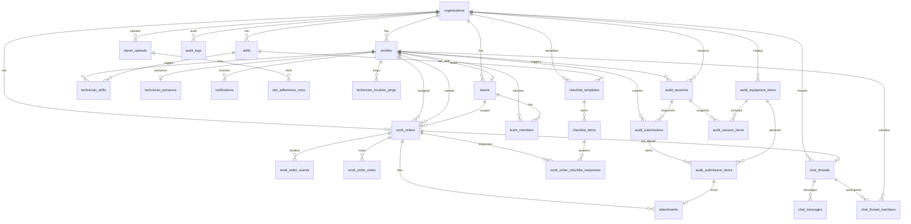

---
title: SCHEMA — Database & API Schema
aliases: [Database, ERD, RLS, API]
tags: [crewpulse, schema, supabase]
---

# SCHEMA.md — Database & API Schema

**Product:** CrewPulse  
**Database:** PostgreSQL via [[SUPABASE]]  
**Related:** [[STACK]] · [[SUPABASE]] · [[ARCHITECTURE]] · [[PRD]] · [[SLOT-ADHERENCE]] · [[MARKITDOWN]] · [[RULES]]

Single organization in MVP (`organizations` still exists so RLS patterns stay realistic).

---

## 1. Database Tables & Relationships (ER Diagram)



**Table list (MVP + 1.5)**

| Table | Phase |
| --- | --- |
| `organizations` | 1 |
| `profiles` | 1 |
| `teams` | 1 |
| `team_members` | 1 |
| `skills` | 1 |
| `technician_skills` | 1 |
| `work_orders` | 1 |
| `work_order_events` | 1 |
| `work_order_notes` | 1 |
| `technician_presence` | 1 |
| `notifications` | 1 |
| `audit_logs` | 1 |
| `attachments` | 1.5 |
| `report_uploads` | 2 |
| `slot_adherence_rows` | 2 |
| `email_outbox` | 3 |
| `technician_location_pings` | 4 |
| `chat_threads` | 1 |
| `chat_thread_members` | 1 |
| `chat_messages` | 1 |
| `checklist_templates` | 4 |
| `checklist_items` | 4 |
| `work_order_checklist_responses` | 4 |
| `audit_equipment_items` | 4e |
| `audit_sessions` | 4e |
| `audit_session_items` | 4e |
| `audit_submissions` | 4e |
| `audit_submission_items` | 4e |

Do **not** create Phase 4 tables until Phase 4 implementation. Spec only.

---

## 2. Table Schemas & Column Definitions

Conventions: `uuid` PKs default `gen_random_uuid()`, `timestamptz` not null default `now()`, `org_id` on every tenant table.

### organizations

| Column | Type | Notes |
| --- | --- | --- |
| id | uuid PK | |
| name | text not null | |
| slug | text unique | `crewpulse-demo` |
| timezone | text not null default `Asia/Manila` | |
| created_at | timestamptz | |

### profiles

| Column | Type | Notes |
| --- | --- | --- |
| id | uuid PK | = `auth.users.id` |
| org_id | uuid not null FK organizations | |
| full_name | text not null | |
| email | text not null | |
| phone | text | |
| role | text not null | check: `admin`, `dispatcher`, `team_lead`, `technician` |
| is_active | boolean not null default true | |
| avatar_url | text | |
| theme | text default `dark` | `dark` \| `light` |
| email_notifications | boolean not null default true | Phase 3 — opt out of email copies |
| created_at | timestamptz | |
| updated_at | timestamptz | |

### teams

| Column | Type | Notes |
| --- | --- | --- |
| id | uuid PK | |
| org_id | uuid not null FK | |
| name | text not null | |
| color | text not null | token name e.g. `teal`, `amber`, `blue` |
| lead_id | uuid FK profiles | nullable |
| created_at | timestamptz | |

### team_members

| Column | Type | Notes |
| --- | --- | --- |
| team_id | uuid PK FK | |
| profile_id | uuid PK FK | |
| is_primary | boolean not null default true | MVP: one primary team |
| joined_at | timestamptz | |

### skills

| Column | Type | Notes |
| --- | --- | --- |
| id | uuid PK | |
| org_id | uuid not null FK | |
| name | text not null | e.g. Fiber Splicing, CPE Installation, Line Repair |
| category | text | |
| unique (org_id, name) | | |

### technician_skills

| Column | Type | Notes |
| --- | --- | --- |
| profile_id | uuid PK FK | |
| skill_id | uuid PK FK | |

### work_orders

| Column | Type | Notes |
| --- | --- | --- |
| id | uuid PK | |
| org_id | uuid not null FK | |
| number | text not null unique | `WO-2026-0001` |
| title | text not null | |
| description | text | |
| status | text not null | see check constraint |
| priority | text not null | `low` `medium` `high` `critical` |
| customer_name | text | |
| customer_phone | text | |
| site_address | text not null | |
| site_lat | numeric | nullable MVP |
| site_lng | numeric | nullable MVP |
| work_order_type | text | `Repair` \| `Install` \| `Migration` — matches CRM/BSS `skillset` |
| order_action_type | text | `PR` \| `PV` \| `CH` — matches CRM/BSS `orderactiontype`; null for Repair |
| required_skill_id | uuid FK skills | nullable |
| team_id | uuid FK teams | nullable |
| assigned_technician_id | uuid FK profiles | nullable |
| scheduled_start | timestamptz | |
| scheduled_end | timestamptz | |
| actual_start | timestamptz | |
| actual_end | timestamptz | |
| created_by | uuid not null FK profiles | |
| created_at | timestamptz | |
| updated_at | timestamptz | |

**status check:**  
`draft`, `queued`, `assigned`, `accepted`, `en_route`, `on_site`, `in_progress`, `paused`, `completed`, `cancelled`, `needs_followup`

Indexes: `(org_id, status)`, `(assigned_technician_id)`, `(org_id, priority)`, `(number)`.

### work_order_events

| Column | Type | Notes |
| --- | --- | --- |
| id | uuid PK | |
| org_id | uuid not null | denormalized for RLS |
| work_order_id | uuid not null FK | |
| actor_id | uuid FK profiles | |
| event_type | text not null | `created` `status_changed` `assigned` `reassigned` `note` |
| from_status | text | |
| to_status | text | |
| payload | jsonb not null default `{}` | |
| created_at | timestamptz | |

### work_order_notes

| Column | Type | Notes |
| --- | --- | --- |
| id | uuid PK | |
| org_id | uuid not null | |
| work_order_id | uuid not null FK | |
| author_id | uuid not null FK | |
| body | text not null | |
| created_at | timestamptz | |

### technician_presence

| Column | Type | Notes |
| --- | --- | --- |
| profile_id | uuid PK FK profiles | |
| org_id | uuid not null | |
| status | text not null | `offline` `available` `on_break` `en_route` `on_site` |
| current_work_order_id | uuid FK work_orders | |
| last_seen_at | timestamptz not null | |
| updated_at | timestamptz | |

### notifications

| Column | Type | Notes |
| --- | --- | --- |
| id | uuid PK | |
| org_id | uuid not null | |
| profile_id | uuid not null FK | |
| type | text not null | |
| title | text not null | |
| body | text | |
| work_order_id | uuid FK | |
| read_at | timestamptz | |
| created_at | timestamptz | |

### audit_logs

| Column | Type | Notes |
| --- | --- | --- |
| id | uuid PK | |
| org_id | uuid not null | |
| actor_id | uuid | |
| action | text not null | |
| entity | text not null | |
| entity_id | uuid | |
| metadata | jsonb | |
| created_at | timestamptz | |

### email_outbox (Phase 3)

Queued email copies of in-app notifications. Processed by Next.js Route Handler (service role). Provider: Resend when `RESEND_API_KEY` is set; otherwise logged in dev.

| Column | Type | Notes |
| --- | --- | --- |
| id | uuid PK | |
| org_id | uuid not null FK | |
| profile_id | uuid not null FK profiles | recipient |
| to_email | text not null | snapshot at enqueue |
| subject | text not null | |
| body | text not null | |
| notification_type | text not null | mirrors `notifications.type` |
| work_order_id | uuid FK | |
| status | text not null | `pending` `sent` `failed` `skipped` |
| error | text | last send error |
| attempts | int not null default 0 | |
| created_at | timestamptz | |
| sent_at | timestamptz | |

### attachments (Phase 1.5)

| Column | Type | Notes |
| --- | --- | --- |
| id | uuid PK | |
| org_id | uuid not null | |
| work_order_id | uuid not null FK | |
| uploaded_by | uuid not null | |
| path | text not null | storage path |
| mime | text | |
| created_at | timestamptz | |

### report_uploads (Phase 2)

| Column | Type | Notes |
| --- | --- | --- |
| id | uuid PK | |
| org_id | uuid not null FK | |
| uploaded_by | uuid not null FK profiles | |
| original_filename | text not null | e.g. `20260615 all status.xlsx` — metadata only; raw file is **not** stored |
| as_of_date | date | parsed from filename `YYYYMMDD` when present |
| status | text not null | `pending` `parsing` `ready` `failed` |
| row_count | int | |
| error | text | |
| created_at | timestamptz | |

### slot_adherence_rows (Phase 2)

Mapped columns only. No customer PII. Spec: [[SLOT-ADHERENCE]].

| Column | Type | Notes |
| --- | --- | --- |
| id | uuid PK | |
| org_id | uuid not null | |
| upload_id | uuid not null FK report_uploads | |
| work_order_number | text not null | |
| slot_raw | text | `2026-06-13 PM Slot` |
| slot_date | date | |
| slot_period | text | `AM` \| `PM` |
| status | text | Cancelled, Completed, … |
| substatus | text | |
| skillset | text | Repair, Install, … |
| queue | text | Regular, VIP |
| team_name | text | technician name in dump |
| contractor_name | text | |
| delay_reason | text | |
| sla_bucket | text | `0-2 Days` … |
| created_at_src | timestamptz | |
| completed_at_src | timestamptz | |
| adhered | boolean | definition in [[SLOT-ADHERENCE]] §3 |
| unique (upload_id, work_order_number) | | |

### Helper functions (SQL)

- `current_profile()` — select from `profiles` where `id = auth.uid()`.
- `is_staff()` — role in `admin`, `dispatcher`, `team_lead`.
- `same_org(org uuid)` — `current_profile().org_id = org`.
- `lead_team_ids()` — teams where `lead_id = auth.uid()`.
- `assign_work_order(p_wo uuid, p_tech uuid)` — SECURITY DEFINER **or** invoked as user with RLS; prefer invoker + RLS.
- `transition_work_order(p_wo uuid, p_to text, p_note text)` — validates machine, writes event, updates presence.

---

## 3. Row Level Security (RLS) Policies

**Global:** RLS enabled on every table above. No policy = no access.

### organizations

- `select` if `same_org(id)`.
- No insert/update from clients. Seed/service role only.

### profiles

- `select`: same org, **and** (staff **or** `id = auth.uid()` **or** same primary team as the viewer if technician — MVP: technicians select **self only**).
- `update`: self (name, phone, theme, avatar, email_notifications) **or** admin (role, is_active).
- `insert`: service role / admin invite only.

### teams / team_members / skills / technician_skills

- `select`: same org. Technicians can read teams/skills (needed for labels).
- `insert/update/delete`: admin (dispatcher may update technician_skills — optional; MVP admin only).

### work_orders

- `select` staff: same org. Team lead: `team_id in lead_team_ids() OR assigned technician in those teams`. Technician: `assigned_technician_id = auth.uid()`.
- `insert`: staff, `org_id` must match profile org, `created_by = auth.uid()`.
- `update`: staff (org/team scope) **or** assigned technician **limited to** status, actual_* timestamps (enforced in RPC; RLS may allow update then RPC checks columns — prefer RPC-only updates for status).

**MVP rule:** status and assignment updates go through RPCs. Direct updates allowed for staff editing title/description/schedule.

### work_order_events / notes

- `select`: if parent work order is selectable.
- `insert`: same as selectable parent; `actor_id` / `author_id` = `auth.uid()`.

### technician_presence

- `select`: staff same org; technician **self only**.
- `insert/update`: self (`profile_id = auth.uid()`). Staff may update for override (admin only).

### notifications

- `select/update`: `profile_id = auth.uid()` (update `read_at` only).
- `insert`: via RPC as invoker or security definer that only inserts for valid assignees.

### audit_logs

- `select`: admin same org.
- `insert`: trigger / RPC only.

### email_outbox

- `select`: admin same org (debug).
- `insert`: RPC only (`notify_profile`).
- `update`: service role only (send worker).

### attachments

- `select`: if parent work order is selectable.
- `insert`: same as selectable parent; `uploaded_by = auth.uid()`.
- No client `update`/`delete` in Phase 1.5.

Storage bucket `job-attachments` (private). Object path `{org_id}/{work_order_id}/{uuid}.{ext}`. RLS on `storage.objects` uses `private.work_order_visible`. Signed URLs expire ≤ 60 minutes.

### report_uploads / slot_adherence_rows

- `select`: staff, same org.
- `insert`: staff via API (upload). Technicians: no access.
- `update/delete`: staff same org (new upload replaces the prior snapshot).

### Realtime

Publication for `work_orders`, `technician_presence`, `notifications`, `work_order_events`. Client must still pass RLS on select.

---

## 4. API Routes by Domain

The Next.js Route Handlers (`apps/web`, `/api/v1`) are the HTTP contract. The browser calls these with the session cookie (and may also send `Authorization: Bearer` for non-browser clients). Base path: `/api/v1`.

### Identity

| Method | Path | Purpose |
| --- | --- | --- |
| POST | _(client)_ `supabase.auth.signInWithPassword` | Login in Next.js, not a custom auth route |
| POST | _(client)_ `supabase.auth.signOut` | Logout |
| GET | `/v1/me` | Current profile |

### Work orders

| Method | Path | Purpose |
| --- | --- | --- |
| GET | `/v1/work-orders` | List |
| POST | `/v1/work-orders` | Create |
| PATCH | `/v1/work-orders/:id` | Edit fields |
| POST | `/v1/work-orders/:id/assign` | Assign |
| POST | `/v1/work-orders/:id/transition` | Status |
| GET | `/v1/work-orders/:id` | Detail + events |

### Presence

| Method | Path | Purpose |
| --- | --- | --- |
| POST | `/v1/presence/heartbeat` | Upsert last_seen |
| POST | `/v1/presence` | available / break / offline |
| GET | `/v1/board` | Initial board |

### Teams & people

| Method | Path | Purpose |
| --- | --- | --- |
| GET | `/v1/teams` | List teams |
| GET | `/v1/skills` | List skills |
| GET | `/v1/technicians` | Staff: assign sheet |
| GET | `/v1/jobs` | Technician: my work orders |
| GET | `/v1/notifications` | Bell |
| POST | `/v1/teams` | Admin |
| POST | `/v1/teams/:id/members` | Admin |
| PATCH | `/v1/profiles/:id/role` | Admin |

### Notifications

| Method | Path | Purpose |
| --- | --- | --- |
| POST | `/v1/notifications/:id/read` | Bell |
| POST | `/v1/notifications/read-all` | Bell |

### Ops

| Method | Path | Phase |
| --- | --- | --- |
| GET | `/health` | 1 |
| POST | `/v1/work-orders/:id/attachments` | 1.5 multipart photo upload |
| GET | `/v1/attachments/:id` | 1.5 signed URL |

### Reports (Phase 2) — [[SLOT-ADHERENCE]]

| Method | Path | Purpose |
| --- | --- | --- |
| POST | `/v1/reports/uploads` | Excel/PDF upload; MarkItDown + typed parse |
| GET | `/v1/reports/uploads/:id` | Parse status |
| GET | `/v1/reports/slot-adherence` | Aggregates |
| GET | `/v1/reports/slot-adherence/rows` | Drill-down, no PII |

### Hardening (Phase 3)

| Method | Path | Purpose |
| --- | --- | --- |
| GET | `/v1/audit-logs` | Admin audit trail |
| POST | `/v1/email/process` | Flush pending outbox (service/cron) |

---

## 5. Request & Response Examples

### createWorkOrder — `POST /v1/work-orders`

Request:

```json
{
  "title": "No internet — fiber cut near Purok 7",
  "description": "LOS on ONT. Suspected aerial cut after typhoon.",
  "work_order_type": "Repair",
  "order_action_type": null,
  "priority": "critical",
  "customer_name": "Subscriber Bunawan",
  "customer_phone": "+63-900-000-0000",
  "site_address": "Purok 7, Bunawan, Davao City",
  "required_skill_id": "33333333-3333-4333-8333-333333333333",
  "team_id": "11111111-1111-4111-8111-111111111111",
  "scheduled_start": "2026-08-20T00:00:00.000+08:00",
  "scheduled_end": "2026-08-20T12:59:00.000+08:00"
}
```

Success:

```json
{
  "ok": true,
  "data": {
    "id": "aaaaaaaa-aaaa-aaaa-aaaa-aaaaaaaaaaaa",
    "number": "WO-2026-0007",
    "status": "queued"
  }
}
```

Error:

```json
{
  "ok": false,
  "code": "VALIDATION",
  "message": "site_address is required"
}
```

### assignWorkOrder — `POST /v1/work-orders/:id/assign`

Request:

```json
{
  "workOrderId": "aaaaaaaa-aaaa-aaaa-aaaa-aaaaaaaaaaaa",
  "technicianId": "bbbbbbbb-bbbb-bbbb-bbbb-bbbbbbbbbbbb"
}
```

Error example:

```json
{
  "ok": false,
  "code": "TECH_OFFLINE",
  "message": "Technician is offline"
}
```

### transitionWorkOrder — `POST /v1/work-orders/:id/transition`

Request:

```json
{
  "workOrderId": "aaaaaaaa-aaaa-aaaa-aaaa-aaaaaaaaaaaa",
  "to": "completed",
  "note": "Spliced fiber. ONT online. Speedtest OK."
}
```

Error:

```json
{
  "ok": false,
  "code": "ILLEGAL_TRANSITION",
  "message": "Cannot go from assigned to completed"
}
```

### Board payload (`GET /v1/board`)

```json
{
  "technicians": [
    {
      "id": "bbbbbbbb-bbbb-bbbb-bbbb-bbbbbbbbbbbb",
      "full_name": "Ana Cruz",
      "team_color": "teal",
      "presence": "available",
      "last_seen_at": "2026-08-17T17:04:00.000Z",
      "current_work_order": null
    }
  ],
  "work_orders": [
    {
      "id": "aaaaaaaa-aaaa-aaaa-aaaa-aaaaaaaaaaaa",
      "number": "WO-2026-0007",
      "title": "No internet — fiber cut near Purok 7",
      "status": "queued",
      "priority": "critical"
    }
  ]
}
```

---

## 6. Phase-based Route Priority

Build in this order. Do not skip ahead to reports or attachments.

### Phase 1 — P0 (blockers)

1. `organizations`, `profiles`, auth trigger  
2. React login via Supabase Auth + `GET /v1/me`  
3. `teams`, `team_members`, `skills`, `technician_skills`  
4. `work_orders` CRUD  
5. `transition_work_order` + `work_order_events` + notes  
6. `assign_work_order`  
7. `technician_presence` + heartbeat  
8. `GET /v1/board` + Realtime in React  
9. `notifications`  
10. Technician `/jobs` + transitions  

### Phase 1 — P1

- Team-lead scoped RLS  
- Audit log writes on assign/cancel  
- Seed script  

### Phase 1.5

- `attachments` + Storage  
- `GET /health`  
- Playwright against demo script  

### Phase 2

- Search query on `work_orders` (`ilike` title/number/address)  
- SLA fields (`due_at`) + overdue filter  
- `report_uploads` + `slot_adherence_rows` + MarkItDown ingest ([[SLOT-ADHERENCE]])  

### Phase 3

- `email_outbox` table + `profiles.email_notifications`  
- Admin audit log list UI (table already exists)  
- Board query parallelization + debounced Realtime invalidation

### Phase 4 — Field operations (spec only until [[PRD]] Phase 4)

Do not migrate these tables in Phase 1–3.

#### technician_location_pings

Foreground GPS samples. Not a breadcrumb product in 4c — keep rows for the active job window; prune after job completes or after 24h (decide in the Phase 4 migration).

| Column | Type | Notes |
| --- | --- | --- |
| id | uuid PK | |
| org_id | uuid not null FK | |
| profile_id | uuid not null FK profiles | technician |
| work_order_id | uuid not null FK work_orders | active job |
| lat | numeric not null | |
| lng | numeric not null | |
| accuracy_m | numeric | meters, nullable |
| recorded_at | timestamptz not null | |
| index (org_id, recorded_at desc) | | |
| index (work_order_id, recorded_at desc) | | |
| index (profile_id, recorded_at desc) | | |

Also add `profiles.location_sharing_opt_in boolean not null default false` in the same Phase 4 migration.

**RLS:** technician insert/select self only, and only when opted in. Staff select same org; team lead limited to lead teams in the API. Technicians never select another tech’s pings.

**Realtime:** add `technician_location_pings` to the publication in Phase 4.

**Write path:** `POST /v1/presence/location` every 30s from the job screen while tracking is legal. Server rejects if not opted in, no active job, or status not in the field set.

#### chat_threads

Standalone chat threads. Three kinds: `direct` (1-to-1 DM), `dispatcher` (default dispatcher-technician channel), `work_order` (auto-created on assignment).

| Column | Type | Notes |
| --- | --- | --- |
| id | uuid PK | |
| org_id | uuid not null FK | |
| kind | text not null | `direct` \| `dispatcher` \| `work_order` |
| work_order_id | uuid FK work_orders | set only for `work_order` kind |
| title | text | nullable; auto-generated for DMs |
| created_at | timestamptz | |
| updated_at | timestamptz | bumped on new message |
| unique (work_order_id) where kind = 'work_order' | | one thread per WO |

#### chat_thread_members

| Column | Type | Notes |
| --- | --- | --- |
| thread_id | uuid PK FK chat_threads | |
| profile_id | uuid PK FK profiles | |
| joined_at | timestamptz | |
| last_read_at | timestamptz | for unread badge |

#### chat_messages

| Column | Type | Notes |
| --- | --- | --- |
| id | uuid PK | |
| org_id | uuid not null | |
| thread_id | uuid not null FK chat_threads | |
| author_id | uuid not null FK profiles | |
| body | text | empty allowed only if attachment_id set |
| attachment_id | uuid FK attachments | Phase 1.5 table; nullable |
| created_at | timestamptz | |

**RLS:** select/insert if user is a member of the thread (`profile_id = auth.uid()` in `chat_thread_members`). `author_id = auth.uid()`.

**Realtime:** add `chat_messages` and `chat_threads` (for updated_at bumps) in Phase 4.

**Dispatcher channel:** when a technician is created, a `dispatcher` thread is auto-created between the technician and their team's dispatcher (or all dispatchers). Used for customer install/repair requests.

#### checklist_templates / checklist_items / work_order_checklist_responses

| Table | Column | Type | Notes |
| --- | --- | --- | --- |
| checklist_templates | id | uuid PK | |
| | org_id | uuid not null | |
| | skill_id | uuid not null FK skills | one active template per skill |
| | name | text not null | |
| | is_active | boolean not null default true | |
| checklist_items | id | uuid PK | |
| | template_id | uuid not null FK | |
| | org_id | uuid not null | |
| | label | text not null | e.g. Hard hat |
| | sort_order | int not null | |
| | is_required | boolean not null default true | |
| | requires_photo | boolean not null default false | critical items |
| work_order_checklist_responses | id | uuid PK | |
| | org_id | uuid not null | |
| | work_order_id | uuid not null FK | |
| | item_id | uuid not null FK | |
| | completed | boolean not null default false | |
| | attachment_id | uuid FK attachments | |
| | completed_by | uuid FK profiles | |
| | completed_at | timestamptz | |
| | unique (work_order_id, item_id) | | |

**Gate:** `transition_work_order` to `en_route` fails with `CHECKLIST_INCOMPLETE` until every required item for the work order’s `required_skill_id` is `completed`. If no skill / no template, gate is skipped (document in the Phase 4 RPC).

**RLS:** templates/items select same org; write admin. Responses: select if WO visible; insert/update assignee or staff.

#### Phase 4 routes

| Method | Path | Purpose |
| --- | --- | --- |
| POST | `/v1/presence/location` | Foreground ping |
| GET | `/v1/board/map` | Dots + site pins for staff |
| GET | `/v1/chat/threads` | List user threads (DMs, dispatcher, WO) |
| POST | `/v1/chat/threads` | Create DM or dispatcher thread |
| GET | `/v1/chat/threads/:id/messages` | Thread messages (paginated) |
| POST | `/v1/chat/threads/:id/messages` | Send message |
| GET | `/v1/checklists/templates` | Admin + technician (needed labels) |
| PUT | `/v1/checklists/templates/:id` | Admin |
| GET/POST | `/v1/work-orders/:id/checklist` | Responses; POST completes items |

---

### Phase 4e — Audit tables (spec only; do not migrate until Phase 4e)

#### audit_equipment_items

| Column | Type | Notes |
| --- | --- | --- |
| id | uuid PK | |
| org_id | uuid not null FK | |
| name | text not null | e.g. Hard hat |
| category | text not null | `ppe` \| `tools` \| `equipment` |
| required_for_field | boolean not null default false | |
| requires_photo | boolean not null default false | |
| sort_order | int not null default 0 | |
| is_active | boolean not null default true | |
| unique (org_id, name) | | |

#### audit_sessions

| Column | Type | Notes |
| --- | --- | --- |
| id | uuid PK | |
| org_id | uuid not null FK | |
| triggered_by | uuid not null FK profiles | |
| session_type | text not null | `individual` \| `broadcast` |
| target_profile_id | uuid FK profiles | null for broadcast |
| deadline_at | timestamptz not null | default now() + interval '30 min' |
| note | text | |
| created_at | timestamptz | |

#### audit_session_items

| Column | Type | Notes |
| --- | --- | --- |
| id | uuid PK | |
| session_id | uuid not null FK audit_sessions | |
| equipment_item_id | uuid not null FK audit_equipment_items | |
| unique (session_id, equipment_item_id) | | |

#### audit_submissions

| Column | Type | Notes |
| --- | --- | --- |
| id | uuid PK | |
| org_id | uuid not null FK | |
| session_id | uuid not null FK audit_sessions | |
| technician_id | uuid not null FK profiles | |
| status | text not null | `pending` \| `submitted` \| `flagged` \| `overdue` \| `resolved` |
| submitted_at | timestamptz | |
| reviewed_by | uuid FK profiles | |
| reviewed_at | timestamptz | |
| unique (session_id, technician_id) | | |

#### audit_submission_items

| Column | Type | Notes |
| --- | --- | --- |
| id | uuid PK | |
| org_id | uuid not null FK | |
| submission_id | uuid not null FK audit_submissions | |
| equipment_item_id | uuid not null FK audit_equipment_items | |
| declared_status | text not null | `present` \| `missing` |
| attachment_id | uuid FK attachments | photo; nullable |
| flag_comment | text | supervisor comment |
| flagged_by | uuid FK profiles | |
| flagged_at | timestamptz | |
| unique (submission_id, equipment_item_id) | | |

**RLS:** See [[AUDIT]] section 6.

**Routes:** See [[AUDIT]] section 7.

---

## Migration notes

- One concern per migration file: `20260818_0001_organizations.sql`, `0002_profiles.sql`, …
- Never edit an applied migration; add a new file.
- Enable Realtime in a dedicated migration (`alter publication supabase_realtime add table ...`).
- Seed is **not** a migration; `supabase/seed.sql` staging only.
