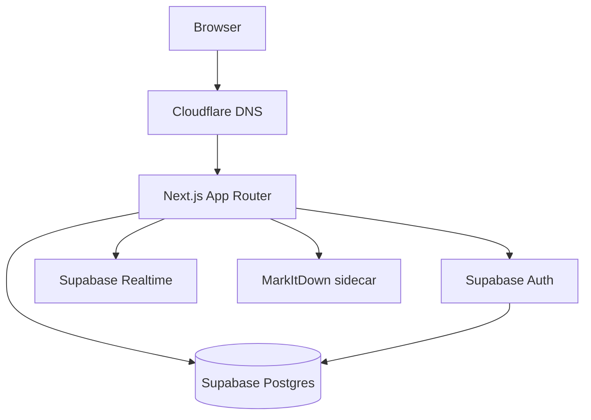

# STACK.md — Locked Technology

**Product:** CrewPulse  
**Related:** [[PRD]] · [[ARCHITECTURE]] · [[CLOUDFLARE]] · [[SUPABASE]] · [[SKILLS]] · [[MARKITDOWN]] · [[SLOT-ADHERENCE]] · [[DESIGN]]

> [!important] Locked 2026-08-18 (CEO update)
> **Next.js** is the application framework. Do not swap this stack without editing this note and [[PRD]] first.

## The four platform choices

| Layer | Choice | Note |
| --- | --- | --- |
| **DNS** | **[[CLOUDFLARE]]** | Authoritative DNS, SSL, hostnames |
| **Database** | **[[SUPABASE]]** | Postgres + Auth + RLS + Realtime (+ Storage later) |
| **App framework** | **Next.js (App Router) + TypeScript** | UI + Route Handlers in `apps/web`. Design via [[SKILLS]] + [[DESIGN]] |
| **Domain** | **`packages/domain`** | Pure TypeScript status machine. No Next.js, no Supabase imports |

## App (Next.js)

- **Next.js** App Router + **React 19** + **TypeScript**
- Routing: file-based `app/`
- Mutations: **Route Handlers** (`app/api/v1/...`), not Server Actions in Phase 1
- Server state: **TanStack Query** for client fetches; Server Components for first paint
- Forms/validation: **Zod** (shared shapes with Route Handlers)
- Styling: **Tailwind CSS v4** + tokens in [[DESIGN]]
- UI primitives: restyled shadcn, not default look
- Auth cookies: **`@supabase/ssr`**. Server clients: **`@supabase/server`** composed with SSR (see [[SUPABASE]])
- **Design engineering skills:** `npx skills add emilkowalski/skills` — see [[SKILLS]]

Not used: Vite SPA, Remix, Vue, Angular, a separate Hono API process.

## Domain and ingest

- Domain package: shared status machine (`packages/domain`)
- Next.js Route Handlers are the **application layer**. Supabase is the **database**. Do not put business status-machine rules only in client components.
- **[[MARKITDOWN]]** (Microsoft) converts Excel/PDF with broken formatting to Markdown.
- Known CRM/BSS template is also parsed as a typed table (201 columns). Report spec: [[SLOT-ADHERENCE]].
- Python sidecar via `uvx`; not inside the Next.js bundle.

## Database

See [[SUPABASE]] and [[SCHEMA]]. No Mongo, Firebase, or Prisma-as-source-of-truth. SQL migrations in `supabase/migrations/` remain the schema source of truth.

**Cloud project (dev):** `slotadmonitoringsystem` · ref `mcxvayoxstpmsqxssdcz` · region `ap-southeast-1`.

## DNS and hosting

See [[CLOUDFLARE]].

| Host | Where it lives | DNS |
| --- | --- | --- |
| Next.js app | Cloudflare Pages (or compatible Node host) | `app` CNAME |
| Supabase | Supabase Cloud | no custom DNS required in MVP |

## Rejected

Vite SPA + separate Hono API, Vercel-as-required-host, Server Actions as the Phase 1 mutation layer, a second database, Prisma-as-source-of-truth, Edge Functions as the main API, Cloudflare Workers as a requirement for Phase 1.

#stack #nextjs #typescript #supabase #cloudflare
