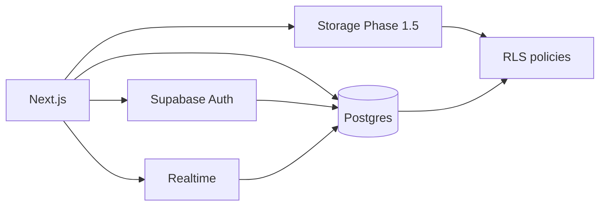

# SUPABASE.md — Database Platform

**Product:** CrewPulse  
**Decision:** **Supabase is the database. Locked.** Auth, Realtime, and Storage also live here. The **application** is Next.js in [[STACK]] / [[ARCHITECTURE]].  
**Related:** [[STACK]] · [[SCHEMA]] · [[ARCHITECTURE]] · [[CLOUDFLARE]] · [[PRD]] · [[RULES]]

> [!important] Source of truth split
> - **How we use Supabase** (this note)
> - **Tables, columns, RLS, API shapes** → [[SCHEMA]]
> Do not add a second database (Prisma-as-source, Mongo, Firebase, D1). Do not replace Next.js Route Handlers with Supabase Edge Functions as the main API.

---

## 1. Why Supabase

CrewPulse needs three things that live in one product:

1. **Postgres** — work orders, teams, events
2. **Row Level Security** — technicians must not see other techs’ jobs
3. **Realtime** — dispatcher board updates without refresh

Supabase is Postgres + Auth + Realtime + Storage. The Next.js app uses it from Server Components, Route Handlers, and the browser (Realtime). That matches [[PRD]] Phase 1.



### What we use

| Product | MVP | Notes |
| --- | --- | --- |
| Postgres | Yes | All tables in [[SCHEMA]] |
| Auth | Yes | Email / password. No public signup UI |
| RLS | Yes | Every user-data table |
| Realtime | Yes | `work_orders`, `technician_presence`, `notifications`, `work_order_events` |
| Storage | Phase 1.5 | `job-attachments` bucket |
| Edge Functions | No | Next.js Route Handlers instead |
| Supabase Vectors / AI | No | Out of scope |
| GraphQL | No | PostgREST via JS client only |

---

## 2. Project layout in the repo

```text
supabase/
  config.toml
  migrations/
    20260818_0001_organizations.sql
    20260818_0002_profiles.sql
    …
  seed.sql                 # staging / local demo only
  snippets/                # optional SQL scratch, not applied
```

SQL migrations are the schema source of truth — not Prisma, not Drizzle schema-as-master. Generate TypeScript types from Supabase after schema changes.

Obsidian note [[SCHEMA]] describes every table. Migrations must match that file.

---

## 3. Environments

| Env | Supabase project | Next.js |
| --- | --- | --- |
| Local / current | **`slotadmonitoringsystem`** (`mcxvayoxstpmsqxssdcz`, `ap-southeast-1`) | `localhost:3000` |

Phase 1 tables, RLS, `assign_work_order` / `transition_work_order`, and Realtime are applied on this project. SQL lives in `supabase/migrations/`. Seed users are **not** applied yet.
| Staging | `crewpulse-staging` | Cloudflare Pages preview |
| Production | `crewpulse-prod` | `app.` via [[CLOUDFLARE]] |

> [!warning] Never
> - Point production `.env` at a throwaway experiment without a backup
> - Put `SUPABASE_SECRET_KEY` in `NEXT_PUBLIC_*`
> - Disable RLS “just for the demo”
> - Commit `.env.local`

### Env vars (document in `.env.example`)

**Public (browser + server)**

```text
NEXT_PUBLIC_SUPABASE_URL=
NEXT_PUBLIC_SUPABASE_PUBLISHABLE_KEY=
```

**Server only**

```text
SUPABASE_URL=
SUPABASE_PUBLISHABLE_KEY=
SUPABASE_SECRET_KEY=                 # seed / admin scripts only
SUPABASE_JWKS_URL=
```

Use the **new** key format (`sb_publishable_…`, `sb_secret_…`). Do not introduce legacy `anon` / `service_role` keys unless a tool still requires them.

Paste real values only in `.env.local` (gitignored).

| Field | Value |
| --- | --- |
| Project name | `slotadmonitoringsystem` |
| Project ref | `mcxvayoxstpmsqxssdcz` |
| Region | `ap-southeast-1` |
| Project URL | `https://mcxvayoxstpmsqxssdcz.supabase.co` |
| Dashboard | `https://supabase.com/dashboard/project/mcxvayoxstpmsqxssdcz` |
| JWKS | `https://mcxvayoxstpmsqxssdcz.supabase.co/auth/v1/.well-known/jwks.json` |

Direct Postgres / pooler URLs need the database password. They are **not** required for the JS client. Do not put the DB password in git. Prisma is not the schema source of truth.

---

## 4. Auth

- Provider: **Email + password**
- Confirm email: **off** on local/dev so demo accounts work
- Public registration: **off** in the product UI. Users are seeded or invited by admin
- Session: `@supabase/ssr` cookies in Next.js; middleware refreshes the access token
- Route Handlers compose `@supabase/ssr` with `@supabase/server/core` (`verifyCredentials`, user-scoped client)
- Profile row: trigger on `auth.users` insert → `public.profiles`

Roles live on `profiles.role`, not only in JWT app_metadata. Middleware reads the profile; RLS enforces rows.

Never use `user_metadata` for authorization. Put role claims in `app_metadata` if they go in the JWT.

---

## 5. Database rules

1. Change tables in [[SCHEMA]] first, then write a migration.
2. One concern per migration file. Never edit an already-applied migration.
3. `org_id` on every tenant table.
4. RLS enabled before any client query.
5. Status and assignment writes prefer RPCs: `assign_work_order`, `transition_work_order`.
6. Enable Realtime in a dedicated migration (`alter publication supabase_realtime add table …`).

Helper functions (defined in SQL, documented in [[SCHEMA]]):

- `current_profile()`
- `is_staff()`
- `same_org(org uuid)`
- `lead_team_ids()`
- `assign_work_order(...)`
- `transition_work_order(...)`

---

## 6. Realtime (monitoring)

Dispatcher board and technician job view subscribe to Postgres changes.

| Table | Why |
| --- | --- |
| `technician_presence` | Live status cards |
| `work_orders` | Kanban / assignment updates |
| `work_order_events` | Timeline while the detail page is open |
| `notifications` | Bell |

Clients filter by `org_id`. RLS still applies to Realtime payloads.

Heartbeat: client upserts `technician_presence.last_seen_at` every 30s. Board treats `> 90s` stale as `offline`.

---

## 7. Storage (Phase 1.5)

| Bucket | Public | Path |
| --- | --- | --- |
| `job-attachments` | Private | `{org_id}/{work_order_id}/{filename}` |

Signed URLs expire in ≤ 60 minutes. Policies: upload/read only if the work order is selectable under RLS.

---

## 8. Clients

| File | Key | Use |
| --- | --- | --- |
| `apps/web/src/lib/supabase/client.ts` | publishable | Browser Auth + Realtime |
| `apps/web/src/lib/supabase/server.ts` | publishable + cookies | Server Components |
| `apps/web/src/lib/supabase/context.ts` | user JWT / secret | Route Handlers via `@supabase/server/core` |
| `apps/web/src/lib/supabase/admin.ts` | **secret** | Seed scripts only |

The secret key bypasses RLS. It must never ship in `NEXT_PUBLIC_*`.

---

## 9. CLI cheat sheet

```powershell
npx supabase login
npx supabase init
npx supabase link --project-ref mcxvayoxstpmsqxssdcz
npx supabase start
npx supabase migration new <name>
npx supabase db reset          # local only — applies migrations + seed
npx supabase db push           # cloud (staging/prod, carefully)
npx supabase gen types typescript --linked > packages/domain/src/database.types.ts
```

Generate types after every schema change. Map `Row` types to domain types in `apps/web/src/db/` ([[RULES]]).

Cursor MCP is scoped to this project in `.cursor/mcp.json`.

Agent skills (already installed):

```powershell
npx skills add supabase/server -a cursor -y
npx skills add supabase/agent-skills -a cursor -y
```

---

## 10. Seed (demo)

`supabase/seed.sql` creates:

- 1 organization
- Admin, 2 dispatchers, 2 team leads, 8 technicians
- 2 teams, skills, mixed work orders and presence rows

Idempotent. Safe on local and staging. **Do not run on production** once real data exists.

Demo passwords live in a local README at implementation time — not in git if they are reused anywhere else.

---

## 11. Security checklist

- [ ] RLS on every table in [[SCHEMA]]
- [ ] Publishable key in the browser; secret key server-only
- [ ] Technician cannot `select` another technician’s work orders
- [ ] Team lead scoped to their teams
- [ ] Storage paths include `org_id`
- [ ] Realtime publication limited to needed tables

---

## 12. How this note relates to the rest

| Question | Open |
| --- | --- |
| What tables exist? | [[SCHEMA]] |
| How does the app call the DB? | [[ARCHITECTURE]] |
| Is this in MVP? | [[PRD]] |
| Coding constraints | [[RULES]] |

#supabase #database #crewpulse
